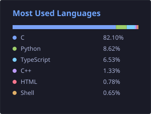

### Hi, I'm Ali Hassan Shah 👋

**Embedded Software Engineer** in Amsterdam, Netherlands.

I build real-time firmware and connected products — multi-MCU systems, USB audio, OTA, and field diagnostics. Mostly **C / C++**, **FreeRTOS**, **ESP32**, and **NXP**.

Currently at **[Createq](https://www.createq.nl/)** · previously **AMD** and **Espressif Systems**

---

### Experience

| Role | Company | Years |
|------|---------|-------|
| Embedded Software Engineer | Createq B.V. — Enkhuizen, NL | Dec 2025 – Present |
| Software Engineer | AMD — Shanghai | Feb 2024 – Dec 2025 |
| Embedded Software Engineer | Espressif Systems — Shanghai | Sep 2022 – Dec 2023 |

**Recent work**
- UAC1/UAC2 USB host on **NXP i.MX RT1020** for multi-speaker retail deployments (Coolblue / Outform)
- Dual-MCU **ESP32 ↔ NXP** UART protocol (40+ commands) with framing, retries, and recovery
- Coordinated **XMODEM OTA** + **MQTT** telemetry for remote fleet updates
- Linux userspace GPU diagnostics & Jenkins/Pytest CI for AMD MI-series (RAS / SR-IOV)
- ESP32 **Matter**, device drivers, and **ESP-FOC** motor control (~20 kHz loops)

---

### Tech stack

**Languages:** C · Embedded C++ · Python  

**Platforms:** ESP32 / ESP-IDF · NXP i.MX RT1020 / MCUXpresso · FreeRTOS  

**Protocols:** USB UAC1/UAC2 · UART · SPI · I2C · RS485 · Modbus RTU · MQTT · Bluetooth audio  

**Tools:** GDB · Git · Jenkins · Pytest · gTest · Linux diagnostics  

---

### Selected projects

- **Multi-Speaker USB Audio Host** — UAC host on i.MX RT1020 with hub power control, hot-plug recovery, and SD/BT I2S mux for up to 4 concurrent speakers
- **ESP32–NXP Dual-MCU Protocol & OTA** — framed UART control path + coordinated remote firmware updates with MQTT monitoring
- **AMD AIDA Kernel-Log CLI** — Python userspace tool to collect dmesg/kernel logs and triage GPU RAS failures
- **ESP-FOC** — Field-Oriented Control on ESP32 (Clarke/Park, SVPWM, multi-driver HAL)
- **Matter Smart Knob** — ESP32 rotary controller with Thread/Wi-Fi commissioning and Arduino packaging

---

### Repositories

Work / product (private — visible if you have access):

| Repo | What it is |
|------|------------|
| [NXP-Audio-Speaker](https://github.com/alibukharai/NXP-Audio-Speaker) | USB audio host firmware (i.MX RT1020) |
| [esp-side](https://github.com/alibukharai/esp-side) | ESP32 / ESP-IDF product firmware |
| [dash-board](https://github.com/alibukharai/dash-board) | Device fleet dashboard & telemetry |
| [flash-tool](https://github.com/alibukharai/flash-tool) | Provisioning / flashing tooling |
| [CreateqNXPTransmitter](https://github.com/alibukharai/CreateqNXPTransmitter) | NXP Wi-Fi audio transmitter |
| [CreateqESPC5Receiver](https://github.com/alibukharai/CreateqESPC5Receiver) | ESP32 audio receiver |

Public / learning:

| Repo | What it is |
|------|------------|
| [Blogs](https://github.com/alibukharai/Blogs) | Technical notes & write-ups |
| [alibukharai.github.io](https://alibukharai.github.io) | Portfolio site |
| [back-to-basics](https://github.com/alibukharai/back-to-basics) | Embedded / systems practice |
| [stm32-lcd](https://github.com/alibukharai/stm32-lcd) | STM32 LCD experiments |

---

### Education

- **M.Eng.** Electronics & Communication Engineering — Fudan University, Shanghai (2019 – 2022)
- **B.S.** Electrical Engineering — COMSATS, Abbottabad (2013 – 2017)

---

### GitHub activity

  
  &nbsp;
  

  

---

### Connect

  
  
  
  

